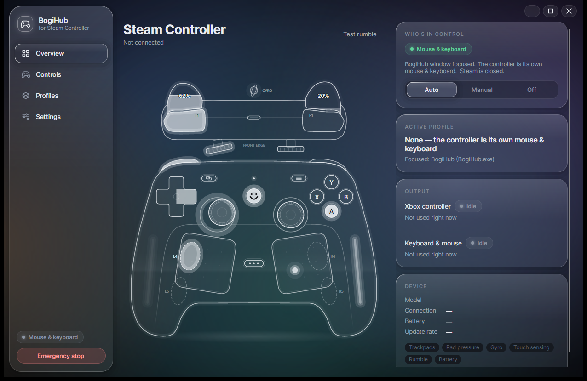
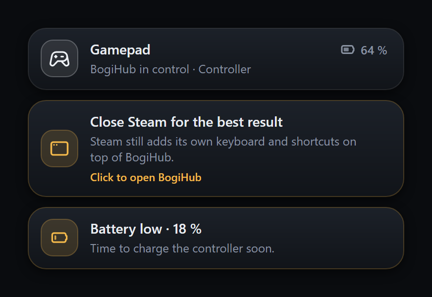
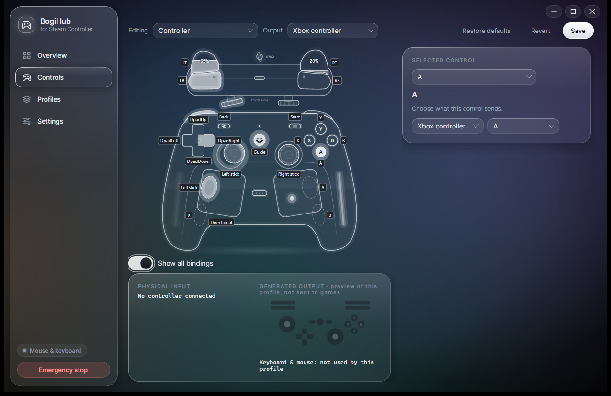

<div align="center">


# BogiHub

**Use your Steam Controller in any Windows game. No Steam needed.**

<a href="https://github.com/OppaiMaster7/BogiHub/releases/download/v0.1.1/BogiHub-Setup-0.1.1.exe"></a>

Version <!--version-->0.1.1<!--/version--> (early preview) &nbsp;·&nbsp; Windows 10 and 11 (64 bit)

**Try the installer first. If it will not open or installation fails, use the ZIP download below.**

**[Requirements](#requirements)** &nbsp;·&nbsp; **[Installer steps](#method-1-installer--try-this-first)** &nbsp;·&nbsp; **[ZIP steps](#method-2-portable-zip--if-the-installer-fails)** &nbsp;·&nbsp; **[How to use it](#how-to-use-it)** &nbsp;·&nbsp; **[Help](#help)**

</div>

| Download | Which one do I need? |
| :--- | :--- |
| **[1. Download BogiHub installer (.exe)](https://github.com/OppaiMaster7/BogiHub/releases/download/v0.1.1/BogiHub-Setup-0.1.1.exe)** — <!--size-->54 MB<!--/size--> | **Try this first.** Installs BogiHub, adds shortcuts, and offers to install ViGEmBus. |
| **[2. Download BogiHub portable (.zip)](https://github.com/OppaiMaster7/BogiHub/releases/download/v0.1.1/BogiHub-Portable-0.1.1-win-x64.zip)** — <!--zip-size-->51 MB<!--/zip-size--> | **Installer blocked or will not open? Try this.** Extract the ZIP, install the included driver, then open BogiHub.exe. |
| **[Download ViGEmBus driver](https://github.com/nefarius/ViGEmBus/releases/download/v1.22.0/ViGEmBus_1.22.0_x64_x86_arm64.exe)** | **Required for gamepad mode.** Official driver download; also included in both BogiHub packages. |

> [!IMPORTANT]
> **ViGEmBus MUST be installed on this PC for gamepad mode to work.** Without it, games will not see BogiHub's
> virtual Xbox controller. With the ZIP, install the driver yourself from the included **drivers** folder.

BogiHub makes the controller a normal Xbox controller in your games, and a mouse and keyboard on the desktop. It
switches between the two by itself, and shows a live picture of every button, stick, trackpad and grip you touch.

> [!NOTE]
> **Early preview.** Everything runs on the real controller, but testing inside games has only just started. See
> [what has been tested](docs/compatibility.md), and please [tell me what works for you](https://github.com/OppaiMaster7/BogiHub/issues/new/choose).

## Requirements

- **Windows 10 or 11, 64 bit (x64).** No separate .NET installation needed.
- **Steam Controller (2026).** The wireless puck has been tested; USB-C and Bluetooth testing is still pending.
- **[ViGEmBus 1.22.0](https://github.com/nefarius/ViGEmBus/releases/download/v1.22.0/ViGEmBus_1.22.0_x64_x86_arm64.exe) installed — REQUIRED for Xbox/gamepad output.** Install it once on each PC. Administrator permission is needed for the driver; BogiHub itself runs without admin rights.

## Install

### Method 1: Installer — try this first

1. **[Download the BogiHub installer](https://github.com/OppaiMaster7/BogiHub/releases/download/v0.1.1/BogiHub-Setup-0.1.1.exe)** and open **BogiHub-Setup-0.1.1.exe** from Downloads.
2. If Windows shows **Windows protected your PC**, use **More info → Run anyway** if that option is available and you trust this download.
3. Click **Next**, then **Next** again. **Leave “Install the ViGEmBus driver” ticked.** If it is already installed, this box is hidden.
4. Click **Install**. Allow the driver's Windows administrator prompt and restart if requested.
5. Click **Finish**, turn on your controller, and open your game.

> [!TIP]
> **Installer will not open? “Unable to execute file in the temporary directory”? Error 4551?**
> Try **[Method 2: download and extract the ZIP](#method-2-portable-zip--if-the-installer-fails)** below.

### Method 2: Portable ZIP — if the installer fails

1. **[Download the portable ZIP](https://github.com/OppaiMaster7/BogiHub/releases/download/v0.1.1/BogiHub-Portable-0.1.1-win-x64.zip)** — choose **BogiHub-Portable-0.1.1-win-x64.zip**, not GitHub's “Source code (zip)”.
2. In Downloads, right-click the ZIP → **Extract All…** → **Extract**. **Do not run BogiHub from inside the ZIP.**
3. **Install ViGEmBus first:** open the extracted folder, open **drivers**, and run **ViGEmBus_1.22.0_x64_x86_arm64.exe**. Finish the driver setup, allow its administrator prompt, and restart if asked. Skip this only if ViGEmBus is already installed on this PC.
4. Return to the extracted folder and double-click **BogiHub.exe**. Keep all the extracted files together.
5. In BogiHub, open **Settings** and check that **Virtual Xbox controller** says **Installed**. Turn on your controller and open your game.

**The ZIP skips BogiHub's installer; it does not guarantee Windows will allow the unsigned app or its libraries.**
If Windows blocks BogiHub.exe too, see [Windows blocks the app](#smart-app-control). A **START-HERE.txt** file with
these steps is included in the ZIP.

<details>
<summary><b>Where did it install? Which file do I open later?</b></summary>
<br>

**Installer:** BogiHub is in your **Start menu** and, if you kept the box ticked, on your **desktop**. The downloaded
**BogiHub-Setup-0.1.1.exe** is only the installer: you can delete it after installing.

**ZIP:** open **BogiHub.exe** from the folder you extracted. You can keep that folder anywhere convenient.
Settings and profiles still live in `%APPDATA%\BogiHub`, so they follow your Windows account rather than the ZIP folder.

</details>

<details>
<summary><b>Want to check the download is the real file?</b></summary>
<br>

Open **PowerShell** in your Downloads folder and run `Get-FileHash .\BogiHub-Setup-0.1.1.exe`. The hash it prints
should be <!--sha256-->`A38FA6393B62AA3A230C20EA3847483C4CF233E48EA652A79D0569CE2DA64FB1`<!--/sha256-->.

For the ZIP, run `Get-FileHash .\BogiHub-Portable-0.1.1-win-x64.zip`. Its hash should be
<!--zip-sha256-->`88DDA6573238A9C35490B362633118383AA6C5A60988B8C49FAFC5FB10271AAE`<!--/zip-sha256-->.

</details>

## How to use it

| To do this | Do this |
| :--- | :--- |
| **Play a game** | Just start it. BogiHub gives the game an Xbox controller by itself. |
| **Use the desktop** | Nothing to do. Outside games, the controller is your mouse and keyboard. |
| **Switch right now** | Hold the **…** button (between the two trackpads) for 1.5 seconds. Two buzzes means gamepad, one long buzz means mouse and keyboard. |
| **Stop everything at once** | Press **Ctrl+Shift+F12**, or click **Emergency stop** in BogiHub. Every held button is let go. |
| **Change what a button does** | Open **Controls** in BogiHub and click that button on the picture of the controller. |
| **Use different controls for each game** | Open **Profiles**. A game's profile turns on by itself when the game starts. |

## What it does

<p align="center">
  
</p>

<table>
<tr>
<td width="50%" valign="top">

**🎮 Gamepad in games, mouse on the desktop.** In **Auto** mode every game (or fullscreen app) gets a virtual Xbox
controller, and the desktop gets the controller's own mouse and keyboard. **Manual** mode uses one of them everywhere.

**🛟 Works next to Steam.** BogiHub shows who is in control, blocks Steam's extra key presses, lets go of stuck keys,
and can close Steam for you.

**🔔 Clear notifications.** Who is in control, low battery, Steam getting in the way, connected or not. They slide in
over your game, never take focus, and let clicks pass through.

</td>
<td width="50%" valign="top">



</td>
</tr>
</table>

**🕹️ Change any control.** Every button, the four rear paddles, the triggers, both sticks (dead zones, speed, or as
keys or a mouse), both trackpads (trackball mouse, scrolling, a direction pad or a stick), the touch sensors and basic
gyro.

**📁 A profile for each game.** Profiles switch by themselves when a game starts, or you pick one yourself. They are
plain files in `%APPDATA%\BogiHub\profiles` that you can import and export.

**🛑 Safe.** The emergency stop (**Ctrl+Shift+F12**, the button in BogiHub or the tray icon) lets go of everything.
So do pausing, switching profiles, disconnecting and quitting. BogiHub runs without admin rights and never changes the
controller's firmware.

<p align="center">
  
</p>

## Playing with Steam open

Even in games that aren't on Steam, a running Steam still uses the controller in its own way: by default **X** opens
Steam's keyboard, **A**, **B** and **Y** press Enter, Esc and Space, and the Steam button shortcuts stay on. BogiHub
blocks those key presses and warns you, but Steam's own pop ups only stop when Steam lets go of the controller. Pick
one of these:

1. **Close Steam while you play.** BogiHub's Overview page has an **Exit Steam** button, and **Close Steam
   automatically** does it for you every time.
2. **Keep Steam open but quiet.** In Steam, open **Settings** > **Controller** and set both the **Desktop Layout** and
   the **Guide Button Chord Layout** to a blank template.

## Help

<details>
<summary><b>Windows says "Windows protected your PC".</b></summary>
<br>

Click **More info**, then **Run anyway**. Windows shows this for new apps that aren't signed yet. If you want to be
sure the file is the real one, check its hash (see [Install](#install)).

</details>

<a name="smart-app-control"></a>
<details>
<summary><b>Windows blocked it completely, with no Run anyway button.</b></summary>
<br>

This can be **Smart App Control**, a Windows 11 protection that can block untrusted apps without an option to
allow just one app. The installer may say **Unable to execute file in the temporary directory**.

If only Setup is blocked, try the [portable ZIP steps](#method-2-portable-zip--if-the-installer-fails).
If BogiHub.exe or a library is blocked after extraction, the ZIP cannot fix that trust decision.

The current preview is unsigned. BogiHub has applied for SignPath signing, but approval and release integration
are still pending: see the [Code signing policy](docs/signing.md). Signing is planned; it does not guarantee that
every Windows security check will allow an app or its dependencies. You can wait for a signed release and check
[Microsoft's Smart App Control FAQ](https://support.microsoft.com/en-us/windows/security/threat-malware-protection/smart-app-control-frequently-asked-questions)
for current options and limitations.

</details>

<details>
<summary><b>My game doesn't react to the controller.</b></summary>
<br>

Open BogiHub's **Overview** page while the game is running. The **Who's in control** card should say **Gamepad**.
If it says **Mouse & keyboard**, hold the **…** button for 1.5 seconds. If gamepad mode can't turn on at all, the ViGEmBus driver is missing: run the
installer again and leave **Install the ViGEmBus driver** ticked. ZIP users: run the driver installer in the
extracted **drivers** folder, then click **Check again** in BogiHub's Settings.

</details>

<details>
<summary><b>Steam's keyboard pops up, or Steam reacts to my buttons.</b></summary>
<br>

Steam is still using the controller. See [Playing with Steam open](#playing-with-steam-open).

</details>

<details>
<summary><b>The mouse and keyboard don't work in one game.</b></summary>
<br>

That game is running as administrator, and Windows blocks other apps' mouse and keyboard input there. The Xbox
controller still works in it.

</details>

<details>
<summary><b>I don't see notifications in my game.</b></summary>
<br>

Games in exclusive fullscreen draw over everything else. Switch the game to **borderless** or **windowed** and they
show up.

</details>

<details>
<summary><b>Will it work in games with anti cheat?</b></summary>
<br>

Each game decides for itself whether it accepts a virtual controller, and that can change with any update, so no
game is guaranteed. BogiHub only uses normal Windows input, and never touches a game's memory.

</details>

<details>
<summary><b>Something else is wrong.</b></summary>
<br>

[Open an issue](https://github.com/OppaiMaster7/BogiHub/issues/new/choose) and tell me what happened. It helps a lot
to attach BogiHub's log: in BogiHub open **Settings** > **Diagnostics** > **Export log**, then drag the file into the
issue.

</details>

**Known limits right now.** Tested with the wireless puck so far; the USB cable and Bluetooth aren't tested yet.
ViGEmBus, the driver behind gamepad mode, is no longer developed by its makers: it works on current Windows 10 and 11,
but a future Windows update could break it.

## Update or remove

**To update**, download the new installer with the button above and run it. It closes BogiHub for you and keeps your
settings and profiles.

**To remove BogiHub**, open Windows **Settings** > **Apps**, find **BogiHub** and choose **Uninstall**. It asks whether
to keep your settings.

**ZIP users:** to update, exit BogiHub from its tray menu, extract the new ZIP into a new folder, and run the new
**BogiHub.exe**. Your settings and profiles are kept. To remove it, turn off **Start with Windows** if enabled,
exit BogiHub, and delete the extracted folder.

## Build it yourself

<details>
<summary>Commands, project layout and the hardware probe</summary>
<br>

You need Windows 10 or 11 (64 bit) and the [.NET 10 SDK](https://dotnet.microsoft.com/download).

```powershell
powershell -ExecutionPolicy Bypass -File scripts/fetch-deps.ps1   # SDL3 3.4.18 and the ViGEmBus setup, checksum verified
dotnet test tests/BogiHub.Core.Tests
dotnet run --project src/BogiHub.App
```

To build the installer you also need [Inno Setup 6.7 or newer](https://jrsoftware.org/isinfo.php)
(`winget install JRSoftware.InnoSetup`). The script writes `dist\BogiHub-Setup-<version>.exe` and points this page's
download button at that version, so commit README.md together with the release.

```powershell
powershell -ExecutionPolicy Bypass -File scripts/build-installer.ps1
```

For a local packaging check, add `-SkipReadmeUpdate` to keep the published download size and checksum unchanged.
Optional signing with your own certificate is described in [Signing BogiHub locally](docs/signing.md#signing-bogihub-locally).

To build the portable ZIP from the same published app files after building the installer:

```powershell
powershell -ExecutionPolicy Bypass -File scripts/build-portable.ps1 -UseExistingPublish
```

Without `-UseExistingPublish`, the script publishes the app first. It bundles the official, checksum- and
signature-verified ViGEmBus installer, adds **START-HERE.txt**, and updates this page's ZIP link, size and hash.
Use `-SkipReadmeUpdate` for local checks. Upload both packages to the matching release before publishing the links.

```
src/BogiHub.Core               input model, mapping engine, profiles, control policy, notices (no OS code; unit tested)
src/BogiHub.Devices.Sdl        SDL3 bindings and the controller reader thread
src/BogiHub.Output             ViGEmBus virtual Xbox controller, SendInput keyboard and mouse
src/BogiHub.Platform.Windows   foreground window, hotkeys, injected input monitor, Steam, autostart
src/BogiHub.Runtime            wires the pipeline together; diagnostics log
src/BogiHub.App                Avalonia UI, hologram, notifications, tray
installer/                     Inno Setup script
tools/BogiHub.Probe            hardware probe
tests/BogiHub.Core.Tests       xUnit
```

```powershell
dotnet run --project tools/BogiHub.Probe            # live view and coverage checklist, saves a report
dotnet run --project tools/BogiHub.Probe -- --list  # 3 second check, no input needed
dotnet run --project tools/BogiHub.Probe -- --vigem # plugs in a virtual Xbox pad for about 2 s and checks it through XInput
dotnet run --project tools/BogiHub.Probe -- --guard # self test of the Steam guard
```

</details>

## Code signing policy

BogiHub has applied to the [SignPath Foundation](https://signpath.org/) open-source code signing program.
**Approval is pending; the current v0.1.1 preview is unsigned.** Once approved and integrated into the release
process, official Windows releases are planned to use free code signing provided by
[SignPath.io](https://about.signpath.io/), with a certificate from the [SignPath Foundation](https://signpath.org/).

See the [Code signing policy](docs/signing.md) for signing scope, maintainer roles and privacy information.
BogiHub remains licensed under the [MIT License](LICENSE).

## Credits

Built on [SDL](https://github.com/libsdl-org/SDL), [Avalonia](https://github.com/AvaloniaUI/Avalonia),
[ViGEmBus](https://github.com/nefarius/ViGEmBus) and [Tabler Icons](https://tabler.io/icons). The full list and their
licences are in [THIRD_PARTY_NOTICES.md](THIRD_PARTY_NOTICES.md).

BogiHub is MIT licensed. It's an independent project, not affiliated with or endorsed by Valve. "Steam" and "Steam
Controller" are trademarks of Valve Corporation; "Xbox" is a trademark of Microsoft.
